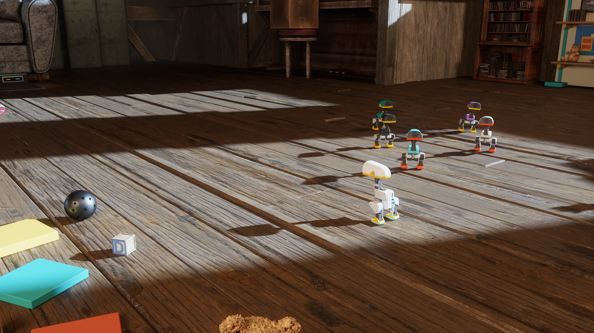

# Isaac workshop: barefoot walking and visual navigation

This is the active MicroDuck research program: a barefoot robot in a customized
inventor's attic, using Isaac Lab, Isaac Sim/Omniverse RTX and Newton. The goal is
reliable walking, turning, recovery and camera-conditioned navigation through
unseen starts, goals and obstacle layouts. **That goal is not yet achieved.**

This directory publishes authored research code, tests, source provenance and
compact evidence. It does not contain a complete launch package, pretrained
weights, robot/scene assets, private compute configuration or vendor software.

The [six-robot attic film prototype](SIX_ROBOT_FILM.md) is a separate current
showcase effort: six policy-controlled robots in one physical world, followed
by exact measured-pose replay from several cameras. Its two-second native
smoke passed independent audit: six robots, 100 controls, 400 solved substeps,
floor contacts for all six, and no nonsole force, falls or resets. Progress was
small and uneven. **The later 20-second attempt failed at 15.16 seconds when
one duck fell.** Its continuous first 12 seconds are admitted for visualization,
with self-contact and a nearly stationary duck disclosed. The movie remains
pending. Five actual Halloween preview views passed all 13 capture-integrity checks and parent-agent image inspection on 2026-10-28. The [swappable seasonal overlay](SEASONAL_THEMES.md) adds reversible props and lighting; Christmas is a starter. Portable helpers preserve the original and excerpt plans separately.



This is an unedited native stopped-timeline render after a cabinet-clearance
correction. It proves the displayed appearance only. Its capture audit passed
34 of 36 gates and retained log/diagnostic failures; it is not a clean-render,
physics or walking qualification. Source scene assets are credited below.

## Actual walking evidence and current limits

[Watch the native 8-second walking/turn/stop clip](media/walk-turn-stop.mp4).
This earlier candidate traveled about 0.498 m forward during the walking phase.
The requested turn was +0.6 rad; measured yaw change during that phase was
−0.0489 rad. Contacts remained disqualifying. Startup depth had no valid pixels at controls0–1; later frames contained valid depth. This did not qualify camera navigation.
The clip is real policy-driven simulation, **not a successful navigation demo**.
It is not the later 75-update candidate described below.

As of the 2026-10-25 snapshot:

- The mixed walk/turn/stop pilot completed 75 PPO updates, 1,800 controls and
  7,200 solved physics substeps. One training episode fell. Checkpoint integrity
  passed; skill was not promoted.
- The later paired teacher/candidate evaluation retained all six complete
  episodes. All six failed strict behavior qualification. The candidate also
  failed the frozen walk contact-retention gate. Turns remained far below the
  requested yaw; keeping an upright body was insufficient.
- Same-state camera acquisition completed 200 explicit render pumps without
  additional solver steps. Sampled floor rays matched current camera poses to
  sub-micrometre median residuals. This validates those rays, not every pixel or
  a measured GPU acquisition timestamp. The clear-view case still latched a
  stop on insufficient frontal depth coverage.
- Camera revision R5 is locally tested and independently reviewed, but has not
  run natively. It combines half-pixel ray calibration, a 30 mm head-forward
  external virtual mount and 15° additional downward rotation. It keeps the
  80% frontal-validity guard, original clipping range and field of view.
- Three public barefoot ONNX foundations passed numerical replay against ONNX
  Runtime on 600 saved observations each. An official velstand native paired
  comparison has been submitted; its result is pending at this snapshot.
  Numerical parity is not proof of walking quality or simulator transfer.

See [STATUS.json](STATUS.json), [evidence-summary.json](evidence-summary.json)
and [foundation-contracts.json](foundation-contracts.json). DuckWing roller
policies and Arena sprint parents are distinct morphologies/contracts; they are
not silently substituted for barefoot walkers.

## Run the CPU suite

From the repository root, using a Python environment with NumPy:

```bash
python3 -m pip install -r programs/isaac-workshop/requirements-test.txt
PYTHONPATH=programs/isaac-workshop/src python3 -m unittest discover \
  -s programs/isaac-workshop/tests -p 'test_*.py'
```

The suite covers geometry, conservative unknown-depth handling, frozen capture
transactions, paired-image causality, raw contact accounting, complete-episode
scoring, command lifecycle and curriculum rejection cases. Its fixtures are
explicitly synthetic. Tests do not initialize Kit/CUDA, train a policy, download
models, submit work or claim native skill.

To inspect a separately obtained model with a known exact hash:

```bash
PYTHONPATH=programs/isaac-workshop/src python3 -m isaac_workshop.onnx_contract \
  --model policy.onnx --sha256 EXPECTED_SHA256 --output inspection.json
```

The small parser supports only the known float32 Sub/Div/Gemm/Elu family; use
an official ONNX checker and ONNX Runtime comparison as separate admission
checks. Model metadata can contain private information: inspect and scrub a
new report before publishing it.

To create a proposal without starting training:

```bash
PYTHONPATH=programs/isaac-workshop/src python3 -m isaac_workshop.prepare_trainer \
  --output rounded-locomotion-proposal.json
```

It deliberately reports `launch_ready: false` until real foundation, reset,
geometry, contact-recorder and native lifecycle integration evidence exists.

## Source map

| Components | Purpose and boundary |
| --- | --- |
| `navigation_bridge`, `probe_controller`, `compare_probe_pair` | Actual camera/mask → bounded command; stale/unknown data latches stop. Hand-coded stopping, not a learned navigator. |
| `camera_readiness`, `capture_alignment`, `alignment_metrics` | Source-bound zero-physics rendering, state/pose/clock preservation and offline ray diagnostics. Diagnostic geometry is never policy input. |
| `head_depth`, `camera_mount`, `command_refresh` | Native camera configuration/readbacks and command-observation lifecycle. Native dependencies are lazy; CPU import does not prove runtime compatibility. |
| `mixed_commands`, `contact_metrics`, `score_locomotion` | Retained pilot exposure, measured raw force accounting and strict complete-trajectory scoring. Thresholds are unchanged. |
| `fresh_checkpoint`, `ppo_source_contract` | Exact model/normalizer/Adam and upstream-method verification helpers. No checkpoint or copied vendor PPO body is included. |
| `curriculum`, `native_curriculum`, `evaluation_contract`, `prepare_trainer` | Next balanced stand/forward/reverse/turn/recovery curriculum and held-out contract. Native integration remains pending. |
| `onnx_contract` | Exact-hash, no-pickle NumPy replay of the supported community export family. No automatic transfer or promotion. |
| `film_motion`, `film_cameras`, `film_excerpt_cameras`, `film_seasonal_cameras` | Shared-world schedule, per-robot history, link-pose conversion and separate original/excerpt camera plans. Two-second smoke verified; full attempt failed; five Halloween excerpt views verified; full film pending. |
| `seasonal_theme`, `seasonal_runtime` | Explicit-root, hash-bound seasonal overlays and disposable light clocks. Halloween five-view preview verified; Christmas starter; external assets and native integration required. |

[SOURCE_MAP.json](SOURCE_MAP.json) records original and public-copy hashes,
import/path adaptations, extracted functions and unchanged definitions.
The historical `head_depth.CameraSpec` default describes the earlier virtual
mount; use the explicit candidate specification in `camera_mount` when evaluating
R5. The legacy recorder's generic floor heuristic is not the calibrated ray
validator; the latter is `alignment_metrics` with explicit half-pixel centers.

## Scene construction and rendering

The [authored scene layers](scene/) preserve the custom composition separately
from licensed source packs: furniture placement and clearance, lights and
materials, the robot display crew, cameras and toy-workshop dressing. They are
scene source, not a redistributed NVIDIA pack. See the scene README for exact
hashes, expected asset roots and the reconstruction boundary.

The native workflow composes OpenUSD layers, verifies source geometry and
support surfaces, separates decorative meshes from the Newton collision domain,
and attaches stripped visuals after physics model creation. A bounded walking
lane currently has source-derived collision coverage; a rendered full room does
not imply that every visible prop participates in physics. In that earlier single-walker setup, parked display robots
are visual-only and excluded from the controlled walker. The new six-robot film
prototype replaces the floor display roles with actual controlled articulations;
its two-second smoke and selected partial-source evidence have been audited, while robust locomotion remains unqualified.

RTX captures preserve a stopped timeline and frozen robot/scene poses. Render
mode and sample settings are read back, but configured sample counts and repeated
identical RGB hashes are not proof of achieved GPU samples or convergence.
SyntheticData frame-discard diagnostics remain visible in retained audits.
No clean-render or material-compilation claim is inferred from an attractive PNG.
The public source and overlays do not by themselves reproduce the whole native
environment: licensed inputs, source-bound collider admission, runtime setup and
worker orchestration are deliberately outside this bundle.

## Native integration and acceptance progression

The research runtime is pinned to Isaac Lab commit
[`b03345bbf2c9a54eb03f9bd823ae19c0ca3a014e`](https://github.com/isaac-sim/IsaacLab/tree/b03345bbf2c9a54eb03f9bd823ae19c0ca3a014e),
its locked Isaac Sim 6.2 extra, Newton source pin and RSL-RL 5.5.1. Use that
checkout's lock rather than combining arbitrary package versions. The native
backlash task uses 200 Hz physics, four substeps per 50 Hz control, 61 actor
observations, 76 critic observations and 14 actions. Named joints, ordering,
normalizers, commands, action transforms, solver and motor models must all match;
shape agreement alone does not establish compatibility.

This public snapshot intentionally omits task-specific scene admissions,
licensed geometry, checkpoints, machine-bound launchers and private raw logs.
`capture_alignment.load_floor` still requires its exact original hash-bound
floor diagnostic assets; those are not redistributed and absence fails closed.
For a different scene, independently validate and bind a new source-derived
floor contract. Do not replace a missing measurement with a fabricated result.

Progression remains:

1. Compare compatible foundations on complete walking, turning and stopping
   trajectories, including actual action targets and every solved contact.
2. Integrate balanced locomotion and measured recovery resets; qualify held-out
   commands/starts with unchanged geometry and contact thresholds.
3. Establish matched actual-camera obstacle-present/absent stopping. A simulator
   goal vector is privileged localization and must remain labeled as such.
4. Train visual obstacle bypass above a frozen qualified locomotor; evaluate
   unseen sides, starts, goals and obstacle rearrangements with full trajectories.
5. Expand collision coverage and validate broader unseen room routes. A bounded
   aisle probe or training smoke does not complete autonomous navigation.

## Attribution and redistribution

The robot and upstream task come from Pollen Robotics/MicroDuck and NVIDIA
Isaac Lab. The rendered workshop uses NVIDIA's authored Old Attic and other
sample-pack content, with task-owned composition, lighting and placement work.
Get source assets from the
[NVIDIA sample-pack catalog](https://docs.omniverse.nvidia.com/usd/latest/usd_content_samples/downloadable_packs.html#sample-scenes-asset-pack)
under their own terms. No scene/texture/MDL pack or robot mesh is redistributed
here. Public policy download references are pinned in the foundation contract;
no third-party checkpoint bytes are bundled. The current authored source uses
the repository license; upstream software and assets retain their own licenses.
